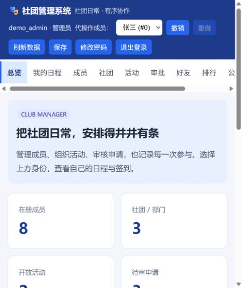

# ClubManager 社团管理系统

面向校园社团负责人和成员的 C++17 应用。把成员管理、入社审批、活动报名、候补、签到和社交关系放在同一套数据中；提供中文命令行和无外部前端依赖的浏览器界面。

## 可以做什么

- **管理成员与组织**：成员标签、CSV 批量导入、姓名与标签检索、社团和子部门、入社和退社。
- **组织活动**：容量管理、按当前积分选择候补、报名资格检查、每周时间段冲突检测、正取与候补名单查看。
- **记录参与**：正取成员每场活动签到一次，自动奖励 10 分；结束活动后保留名单和签到历史。
- **个人日程**：查看本人正取、候补、已签到及已结束活动，按星期与开始时间排序。
- **处理申请**：高优先级先处理，同优先级按提交顺序；防止重复申请，支持本人撤回。
- **观察社团运行**：统计总览、报名进度、成员 Top-K、个人排名、区间人数、社团积分排行。
- **关系与公告**：好友关系、二度人脉、最短关系路径、好友活动推荐、社团公告。
- **管理数据**：完整操作撤销/重做、成员与活动名单 CSV 导出、自动存档、兼容旧示例存档。
- **账号与权限**：密码登录、管理员/普通成员角色、成员绑定、启停账号、改角色、重置密码；普通成员只能操作自己的报名、签到和入社申请。



## 推荐运行方式（Windows + WSL）

本项目后续以 WSL Ubuntu 24.04 为主要开发环境。C++ 服务运行在 Linux 中，Windows 浏览器访问本机页面；无需关闭 Windows 智能应用控制。

**日常使用：双击 `启动社团管理.cmd`，停止时双击 `停止社团管理.cmd`。** 首次启动会在窗口里引导设置管理员 `admin` 的密码（输入两次，输入时不显示）；之后双击即可自动准备构建、启动服务并用 Windows 默认浏览器打开 `http://127.0.0.1:8090/`。网页就绪后启动窗口自动关闭，服务在 WSL 后台继续运行；无需保留命令行窗口。再次双击启动只打开现有网页；端口被其他服务占用时会明确报错。

这两个入口控制项目根目录的正式服务，与 8091 演示环境独立。可分别发送到桌面快捷方式；共用代码、账号和数据，不复制程序。停止时核对进程启动时间、可执行文件和数据目录，只结束匹配服务，不关闭整个 WSL。重复停止会提示未运行。运行日志 `.club-service.log` 每次启动覆盖，不累积历史日志；错误时启动窗口会保留提示，不修改 Windows 安全策略。

已有 `Ubuntu-24.04`、`g++`、CMake、Python 3 时，在项目目录运行：

```powershell
.\run-wsl.ps1 -Action test       # 构建并执行核心、HTTP/CLI、权限测试
.\run-wsl.ps1 -Action init       # 首次设置管理员，输入两次密码
.\run-wsl.ps1                   # 启动服务，然后打开 http://127.0.0.1:8090/
```

可用 `-Port 8091` 更改端口，`-Distro Ubuntu-24.04` 选择已安装发行版，`-Username admin` 指定初始化/重置账号名。`-Action build` 只构建，`-Action demo` 运行内置演示，`-Action reset` 用于停服后在本机重置密码。按 Ctrl+C 停服；运行目录是项目根，真实数据与账号不会放进构建目录。

Linux 产物位于 WSL 用户的 `~/.cache/clubmanager/<项目路径哈希>/`，实际路径写入 `build/wsl-build-path.txt`；使用 Linux 文件系统可避免挂载盘时间戳偏差造成构建警告。若 Ubuntu 没装 `libssl-dev`，脚本通过 apt 校验下载官方 OpenSSL 包，解包到项目私有 `build/wsl-openssl/`；不运行安装脚本，不需要 sudo。首次准备依赖需要网络，之后使用本地 SDK；它不会随系统自动更新，需要定期重新准备或改用系统维护的开发包。没有 `g++`/CMake/Python 时，应先在 Ubuntu 安装 `build-essential cmake python3 libssl-dev`。WSL 的标准开发方式见 [微软文档](https://learn.microsoft.com/windows/wsl/setup/environment)。

在 Ubuntu 终端中也可以运行 `bash scripts/run-linux.sh test`、`bash scripts/run-linux.sh init`、`bash scripts/run-linux.sh run`。

依赖准备成功后，脚本自动删除一次性下载索引、软件包及不用的静态库。日常只保留一套 WSL 增量构建、必要动态依赖和源码。清理旧 Windows 构建与历史临时文件可运行 `./scripts/clean-build.ps1`，或先加 `-WhatIf` 查看清理范围；账号、业务数据和当前预览会保留。

## 原生 Windows 构建（兼容入口）

需要 MinGW-w64 的 `g++`（C++17）、PowerShell；运行接口测试另需 Python 3。把编译器加入 PATH。

```powershell
.\build.ps1                  # 编译，生成 build/club.exe
.\build.ps1 -Test            # 编译并运行单元测试及真实 HTTP/CLI 测试
.\build\club.exe demo        # 内置演示，不修改工作存档
.\build\club.exe auth init admin  # 首次运行：按提示输入两次密码，无默认密码
.\build\club.exe gui         # 浏览器界面，默认 http://127.0.0.1:8090
```

导入随项目提供的虚构示例（8 位成员、3 个社团/部门、2 场活动）：

```powershell
.\build\club.exe load examples/sample_data.txt
.\build\club.exe gui
```

`load` 会将指定文件导入为当前工作存档；已有真实数据时，先用 `save backup.txt` 导出备份。服务器运行时，请使用网页操作这份数据；不要同时用另一个 CLI 进程修改同一个工作目录。

原生 Windows 构建脚本已在中文路径中编译成功，但当前机器的智能应用控制阻止新 EXE 运行；最终运行与测试已转到 WSL。部分 MinGW Make 版本不能正确处理中文路径，原生 Windows 兼容构建使用上述脚本。

## CMake 构建（Linux 或支持项目路径的工具链）

```bash
cmake -S . -B build -DCMAKE_BUILD_TYPE=Release
cmake --build build -j
ctest --test-dir build --output-on-failure
./build/club demo
./build/club gui
```

CMake 最低 3.16，编译器支持 C++17。Windows 使用系统 BCrypt；Linux/macOS 的密码学实现依赖 OpenSSL 开发库（如 Debian/Ubuntu 的 `libssl-dev`）。不依赖数据库或在线服务。检测到 Python 时，CTest 自动包含 HTTP/CLI 和权限测试。各平台实际验证状态见 [验证记录](docs/verification.md)。

## 使用与规则

首次在本机通过 `auth init admin` 设置管理员，启动后用该账号登录。在“成员”页添加在册成员，再在“账号权限”页创建普通成员账号并绑定成员。系统不提供公开注册，也没有默认密码。

管理员可以管理成员、社团、活动、审批、好友、排行、公告、数据和账号；顶栏选择的是管理员**代操作的成员**。普通成员的身份由登录账号固定，页面只有我的日程、活动报名、社团入社、我的申请、我的公告；不能修改积分或标签、审批、直接入社、调整容量、导入导出、撤销全局操作或管理账号。双方均可修改自己的密码和退出登录。

成员/活动管理页支持表内搜索；活动名单支持查看与 CSV 下载；成员页可展开批量导入。权限由服务端检查，隐藏按钮不是权限边界。详细流程、接口和角色矩阵见 [登录与权限说明](docs/authentication.md)。

- 报名必须具备全部所需标签；无所需标签则公开报名，不要求先加入主办社团。
- 时间使用 `day=0..6`（周日到周六），分钟范围 `[0,1440]`，要求开始时间小于结束时间。未设置结构化时间的活动仅展示文本，不检测冲突。
- 冲突判断使用半开区间 `[start,end)`，前一场结束后立即开始下一场不算冲突。
- 正取活动占用时间；候补不占用时间。报名和候补转正都会检查与现有正取活动的冲突。暂不合格者保留候补，在下次补位时重新检查。
- 候补按**当前积分降序，同分成员 ID 升序**提拔。缩容保留已签到者，其余正取按当前积分择优保留；不能缩到已签到人数以下。
- 签到奖励固定 10 分；重复签到、候补签到、结束后签到都会被拒绝。已签到者不能取消报名。撤销签到会同时撤销积分。
- 结束活动后停止报名、取消、签到和容量修改，并释放时间冲突占用；候补名单也作为历史保留。结束可以撤销。
- “查看下一条待审”只查看，不会丢失申请；通过、拒绝或撤回才让申请离开待审队列。
- 删除成员前必须先处理其在册社团、活动参与和待审申请；删除社团前必须清理其成员、子部门、活动和待审申请。删除可撤销。
- 撤销/重做历史仅在当前进程内有效；网页是持续会话，单次 CLI 调用不是。载入成功会重置操作历史。
- 活跃度不低于零；加减积分使用宽整数计算并限制在 `int` 范围内。成员排行榜沿用原实现的 `(score,id)` 降序，同分 ID 较大者在前；CLI 排名从 0 开始，网页显示从 1 开始。

常用新命令：

```text
club stats
club schedule <memberId>
club activity checkin <memberId> <actId>
club activity close <actId>
club app withdraw <appId> <memberId>
club export members <path.csv>
club export roster <actId> <path.csv>
club save <backup.txt>
club load <backup.txt>
club help
```

完整的原有命令见 `club help`。例如：

```powershell
.\build\club.exe member add Alice 2026 tag:Python
.\build\club.exe club create 编程社 技术 2026-10 学习交流
.\build\club.exe activity addtimed 0 编程交流 20 6 840 960 tag:Python
.\build\club.exe activity signup 0 0
.\build\club.exe activity checkin 0 0
.\build\club.exe schedule 0
.\build\club.exe export roster 0 roster.csv
```

上述 ID 示例假设从空工作目录开始运行。

## 导入与存档

CSV 使用 UTF-8，支持 BOM、CRLF、可选表头、带引号的逗号和双引号字段：

```csv
姓名,年级,标签
张三,2026,Python;算法
"Doe, Jane",2025,C++
```

导入返回新增、重名跳过、格式错误三项统计，整批可撤销。只导入姓名、年级、标签；导出的 ID/积分列是报告字段，不会用导入篡改积分。CSV 不支持跨行字段；导出会对可能被表格软件识别为公式的用户文本加前导单引号。

默认存档是**运行工作目录**中的 `club_data.txt`，不会自动上传。格式 v3 仍为可读文本，`|` 分字段、`;` 分标签，使用百分号编码保存分隔符、换行及控制字符；包含签到名单、活动结束状态、成员稳定绑定标识。v1 示例和 v2 存档仍可加载，下一次保存会写成 v3。

账号和加盐密码哈希单独保存为 `club_accounts.txt`，不会出现在业务 JSON 或 CSV 导出中。备份时同时保存这两个文件；`save` 命令只导出业务数据。导入另一份数据或旧格式时，编号相同不代表同一个人：原成员绑定失效的账号会被拒绝登录，管理员核实身份后可重新绑定。账号权限变更不进入业务撤销栈。

读取在临时对象中完成：检查头部、字段数量、数字、ID、引用关系、容量、时间、组织环路及正式报名冲突，全部通过才替换当前状态。失败时当前数据和撤销历史保持不变。保存先写入同目录临时文件，确认写入成功后替换目标文件；失败清理临时文件并报告错误。它不是数据库事务，不提供跨进程写入协调或停电级备份。

## 数据结构与设计

| 模块 | 关键实现与作用 | 复杂度与取舍 |
|---|---|---|
| 姓名索引 | `hash_map.cpp`，链地址哈希表 | 查找平均 O(1)，最坏 O(n) |
| 活跃度索引 | `avl.cpp`，带子树计数的 AVL | 更新/排名 O(log n)，Top-K O(log n+k)；区间计数为两次前缀计数 O(log n) |
| 标签索引 | `inverted_index.cpp`，有序倒排列表 | 查询 AND/OR 使用归并；数组插入/删除最坏 O(n)，不是 O(log n) |
| 候补与审批 | `heap.h`，二叉堆 | 入堆 O(log n)；为反映积分变化，转正扫描当前候补并重建堆，O(w log w)，另加资格检查成本 |
| 关系网络 | `friend_graph.cpp`，无向邻接表与 BFS | 最短路径 O(V+E)，推荐按共同好友计数排序 |
| 组织层级 | `system.cpp`，父子节点与 DFS | 遍历 O(C)，载入时检查环路 |
| 撤销/重做 | 两个命令栈、操作前后快照 | 能恢复补位造成的全部变化；快照消耗与操作涉及的名单规模有关 |
| 日程与统计 | `features.cpp` | 统计遍历实体与名单；个人日程筛选后按时间排序 |
| 持久化 | `persistence.cpp`、`data_io.cpp` | 临时对象校验、索引重建、临时文件替换 |

关键哈希表、AVL、堆、倒排索引的逻辑在项目内实现。图的底层邻接容器和计数使用 `std::unordered_map` / `std::unordered_set`，BFS 使用 `std::queue`；Web 路由参数使用 `std::map`。`containers.h` 中另有教学用栈/循环队列，不能声称项目完全未使用 STL 容器。

## 目录

```text
include/              数据模型、数据结构与业务接口
src/system.cpp        成员/社团/活动/审批及操作历史
src/features.cpp      签到、日程、统计、CSV 导出
src/persistence.cpp   存档编解码及载入校验
src/data_io.cpp       CSV 与原子文件替换
src/auth.cpp          加盐密码哈希、账号持久化、会话与登录限速
src/web_auth.inc      Web 认证入口、角色授权和本人数据范围
src/main.cpp          命令行
src/web_server.cpp    HTTP 服务、JSON 路由与内嵌中文页面
build.ps1             Windows 构建与测试入口
run-wsl.ps1           Windows 调用 WSL 的日常开发入口
启动社团管理.cmd       双击启动，首次初始化管理员并自动打开网页
停止社团管理.cmd       双击停止对应的正式服务
scripts/launch.py     后台运行、重复启动保护与进程身份校验
scripts/run-linux.sh  Linux 构建、测试、初始化和启动
scripts/clean-build.ps1 清理本项目旧构建与临时缓存
CMakeLists.txt        跨平台构建入口
tests/                数据结构、业务回归与 HTTP/CLI 测试
examples/             虚构示例数据
docs/                 演示截图、验证与协作记录
```

## 验证

`run-wsl.ps1 -Action test` 会在 Linux 构建目录执行 C++ 单元测试，并在独立临时目录、随机本地端口启动真实 HTTP 与权限测试，不修改个人工作存档。当前 WSL 验证为 641 项核心检查、55 项 HTTP/CLI 检查和 197 项权限检查，合计 893 项通过。

验证覆盖正常流程和以下回归场景：报名/候补/取消的完整撤销与重做、候补转正的冲突复查、按积分缩容、资格标签、一次性签到积分、结束活动、撤回与审批、索引排除已删除成员、特殊字符存档、损坏文件不污染状态、CSV 引号与表头、错误 HTTP 参数、旧存档兼容及 CLI 导出。AVL 使用固定随机种子与简单数组实现对照验证排名、范围计数、Top-K 和删除。

实际结果与演示流程见 [验证记录](docs/verification.md)，代表性修复决策见 [AI 协作记录](docs/ai-collaboration.md)。

## 局域网与已知限制

默认仅监听本机。如需可信局域网共用：

```powershell
$env:CLUB_LAN='1'
$env:CLUB_PORT='8090'         # 可选
.\build\club.exe gui
```

必要时由运行者配置防火墙；程序不自动提权或修改防火墙。`CLUB_NO_BROWSER=1` 可关闭自动打开浏览器。

Web 已实现密码登录和服务端角色权限，默认监听本机。内置服务器使用 HTTP，没有 TLS；局域网正式传输密码时应放在配置正确的 HTTPS 反向代理后，并设置 `CLUB_SECURE_COOKIE=1`（代理须保留外部 Host）。该变量仅启用 Secure Cookie 和 HTTPS Origin 校验，不会自动提供 TLS。CLI 是服务器本机所有者的维护工具，不受 Web 成员角色限制；普通成员只应获得网页账号，不能获得服务器目录或命令行访问权。

其他浏览器点击“刷新数据”可看到更新；当前没有 WebSocket 实时推送。时间是每周时段，没有真实日期、跨周周期或跨午夜活动。签到由用户手动触发，没有定位或签到时窗。撤销历史不限制条数；大数据场景尚需分页和持久化审计日志。Web 服务器为教学级实现，尚未做高并发压测或生产安全审计。

## 来源与 AI 使用声明

- 示例数据是虚构的社团和成员，用于演示与测试。
- 本次使用 **OpenAI Codex** 辅助代码审查、功能设计、实现、回归测试、浏览器验证和文档整理；保留了原有数据结构和项目架构。
- 本次未复制外部项目代码；使用 C++ 标准库、Windows/POSIX socket API 和 Python 标准库。密码学使用 Windows BCrypt 或 Linux OpenSSL；没有引入前端框架。
- 本人承担的原始设计、修改与判断：**请项目作者根据实际贡献补充，提交前自行阅读并解释关键代码。** 这里不代替作者声明其未确认的工作。
- 仓库已有 [MIT 许可证](LICENSE)，本次保留原许可证文件；原有源码来源未进一步核验。
- 课程 PDF、姓名院系、GitHub 链接及最终提交版本需由作者确认后准备；项目改进不等同于已完成课程提交。
